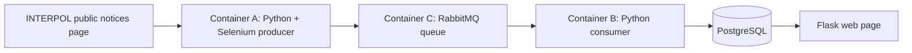

# Interpol Red Notices — Python Data Pipeline

**Portfolio project · Python · Selenium · RabbitMQ · PostgreSQL · Flask · Docker Compose**

This prototype explores an event-driven data ingestion workflow: a Selenium-based collector reads information from the public INTERPOL Red Notices site, publishes records to RabbitMQ, and a Python consumer stores them in PostgreSQL for display through a Flask page.

> **Status:** Historical proof of concept, not a maintained production service. The source has known reliability and security limitations described below. Its Docker setup has not been revalidated against current dependency versions.

## Architecture



| Component | Responsibility | Main files |
| --- | --- | --- |
| Container A | Collect notices and publish messages | `Container_A/scraper_producer.py` |
| Container C | Deliver messages between the producer and consumer | `rabbitmq:3` in `docker-compose.yml` |
| Container B | Consume messages, save records, and render the web interface | `Container_B/consumer_db.py`, `Container_B/webapp.py` |

PostgreSQL runs inside Container B in the existing implementation; it is not a separate Compose service.

## What the project demonstrates

- Browser-driven ingestion of publicly available data with Python and Selenium.
- Producer/consumer messaging using a durable RabbitMQ queue.
- PostgreSQL persistence and a lightweight Flask reporting interface.
- Multi-container application structure with Docker Compose.

## Repository layout

```text
interpol_rednotices/
├── Container_A/
│   ├── Dockerfile
│   ├── reqs.txt
│   └── scraper_producer.py
├── Container_B/
│   ├── Dockerfile
│   ├── consumer_db.py
│   ├── pg_hba.conf
│   ├── reqs.txt
│   ├── start_app.sh
│   ├── templates/definition.html
│   └── webapp.py
├── Container_C/
│   └── Dockerfile
└── docker-compose.yml
```

## Local exploration

Prerequisites: Docker and Docker Compose. From the repository root, the intended workflow is:

```bash
docker compose up --build
```

The Compose file maps the Flask service to `http://localhost:8080`. **This is a description of the intended interface, not a claim that the current project starts successfully.** The legacy configuration has hard-coded networking and startup assumptions that need to be resolved before it can be treated as a reliable one-command demo.

## Known limitations and next improvements

1. **Networking:** Both Python messaging scripts connect to a hard-coded `172.17.0.2` address instead of the Compose service name `container_c`.
2. **Message safety:** The consumer parses queue bodies using `eval()`. This should be replaced with JSON serialization and `json.loads()` before processing any untrusted data.
3. **Configuration:** PostgreSQL credentials are hard-coded for development and need environment-variable configuration and stronger defaults.
4. **Startup lifecycle:** `Container_B/start_app.sh` runs the message consumer before the Flask process. The consumer's blocking behavior may delay or prevent the web UI from starting.
5. **Scheduling:** An `INTERVAL` environment variable appears in Compose, but the current producer script performs a single collection pass rather than a scheduled loop.
6. **Quality:** Automated tests, CI, dependency pinning, and end-to-end setup verification have not yet been added.

These are candidates for a follow-up engineering cleanup, separate from this documentation update.

## Data and disclaimer

The source is the [public INTERPOL Red Notices site](https://www.interpol.int/How-we-work/Notices/Red-Notices/View-Red-Notices/). This educational project is not affiliated with INTERPOL. Red Notices and public listings can change; use INTERPOL's official website for current information. Do not treat this demo as a current or authoritative people-identification database.

## Author

[Tarik Salay](https://github.com/tariksalay) · [LinkedIn](https://www.linkedin.com/in/tariksalay/) · [Portfolio](https://tariksalay.github.io/)
