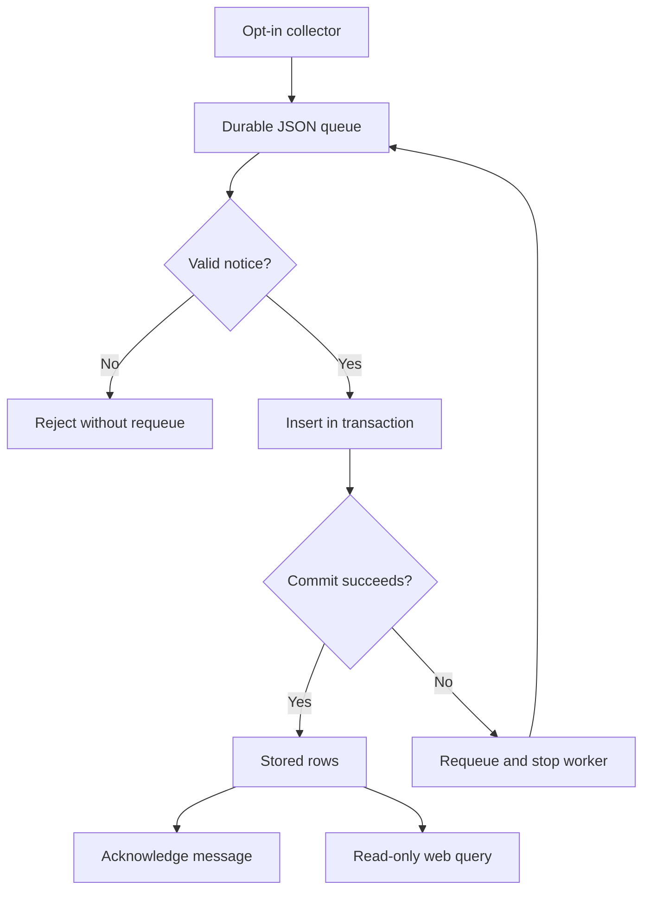

# Red Notices Data Pipeline: project walkthrough

[Overview](../README.md) · [Code reference](CODE_REFERENCE.md) · [Development guide](DEVELOPMENT.md)

## Responsibility boundaries

The collector should know how to read source records and publish them. The consumer should know how to validate a message and persist it. The UI should query stored rows without having to run collection first. Compose separates those responsibilities so a waiting consumer does not block the web process.

## Active services and files

| Compose service | Role | Main implementation |
| --- | --- | --- |
| `container_a` | Opt-in Selenium collector and JSON publisher | [Container_A/scraper_producer.py](../Container_A/scraper_producer.py) |
| `container_c` | RabbitMQ broker, durable queue storage | [docker-compose.yml](../docker-compose.yml) |
| `consumer` | Independent queue consumer | [Container_B/consumer_db.py](../Container_B/consumer_db.py) |
| `postgres` | Independent database with a persisted volume | [database/schema.sql](../database/schema.sql) |
| `container_b` | Gunicorn/Flask read-only UI | [Container_B/webapp.py](../Container_B/webapp.py) |

[Container_B/database.py](../Container_B/database.py) centralizes short-lived PostgreSQL connection creation using standard `PG*` environment settings. The web and consumer services share an image, but run different commands. Historical files under [Container_C](../Container_C) and the old PostgreSQL startup/configuration scripts are retained; the current Compose broker uses an official image directly, and PostgreSQL is no longer installed inside the app container.

## Message and row objects

| JSON field | Contract | PostgreSQL column |
| --- | --- | --- |
| `Name` | Nonempty string, at most 100 characters | `name_surname` |
| `Age` | String, at most 100 characters | `age` |
| `Nationalities` | String, at most 100 characters | `nationality` |

The database adds a serial `id`. The consumer does not reinterpret age as a number or split nationality strings. There is no stable upstream identifier or ingestion timestamp in the current schema.

`findRedNotices(max_pages)` starts Chromium, extracts parallel name/age/nationality fields, checks matching field counts, and quits the driver in a `finally` block. Collection defaults to one page. Pagination is bounded and must be rechecked against live markup. This is one collection run, not an automatically scheduled refresh.

`send_to_rabbitmq` declares `red_notices_queue`, publishes persistent JSON messages with a content type and mandatory routing, enables publisher confirmations, and closes the connection.

## Delivery and failure behavior

`callback` decodes/validates first, inserts with parameters inside a transaction, closes the database connection, and acknowledges after commit. Database errors request requeue and propagate so the worker can restart. A malformed message is not repeatedly retried. The queue is configured with one unacknowledged message at a time.

Delivery is at least once: a crash between commit and acknowledgment can create a duplicate on retry. Re-running collection also appends rows. Exactly-once delivery, deduplication, dead-letter retention, and scheduled refreshes are not implemented.

## UI and persistence

`definition` queries at most 1,000 rows ordered by descending `id`, closes the connection, and passes rows to [the template](../Container_B/templates/definition.html). The displayed time is page-render time, not the last ingestion time. Jinja escapes record text in the tested rendering path.

Database/broker ports remain internal to Compose. The database schema initializes on a fresh PostgreSQL volume; existing data needs a deliberate migration if its schema differs. No destructive volume operation is included in the startup instructions.

The public source is [INTERPOL's notices page](https://www.interpol.int/How-we-work/Notices/Red-Notices/View-Red-Notices/). This project is not affiliated with INTERPOL, and stored rows must not be treated as current authoritative listings. Tests never scrape the live site.
